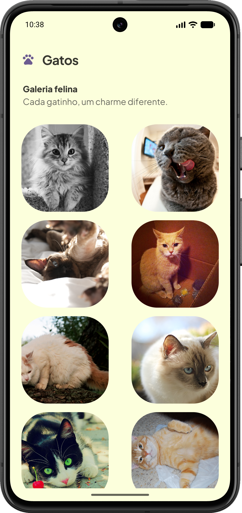
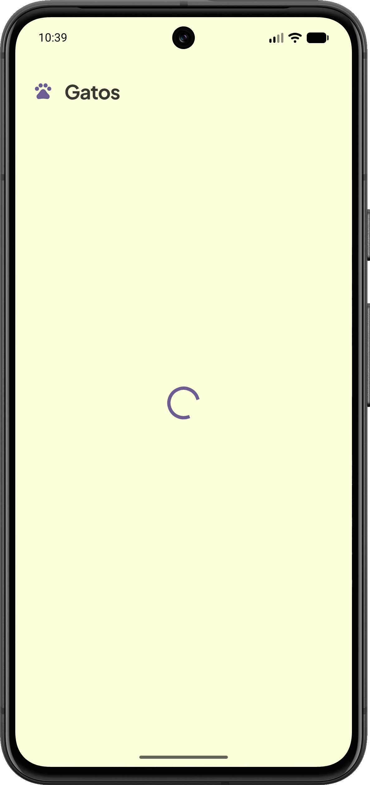
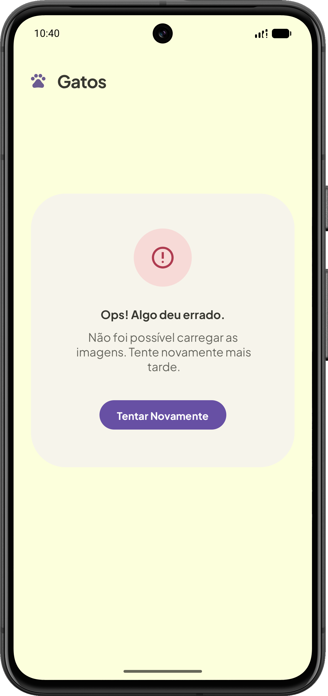

# 🐱 Gatos

Aplicativo Android nativo que exibe uma galeria de imagens de gatos consumidas da TheCatAPI. Desenvolvido em Kotlin, com interface em XML e Android Views.

Este é um projeto de estudo para praticar desenvolvimento Android nativo, corrotinas e integração com APIs REST. A proposta é explorar o fluxo completo de uma requisição: buscar os dados, transformar a resposta em objetos Kotlin e atualizar a interface, incluindo os estados de carregamento e erro.

## Screenshots
<p align="center">
  
  
  
</p>

## Funcionalidades

- Galeria de imagens em uma grade de duas colunas.
- Carregamento de imagens a partir de URLs.
- Atualização da galeria ao puxar a lista para baixo.
- Indicador de carregamento.
- Tela de erro com botão para tentar novamente.

## Conceitos praticados

- **Android Views e View Binding:** construção de layouts XML e acesso às views pelo binding gerado.
- **ViewModel:** organização da busca de dados fora da Activity.
- **Corrotinas:** requisições assíncronas com funções `suspend` e `viewModelScope`.
- **StateFlow:** exposição dos resultados da consulta para a interface, com coleta em `lifecycleScope`.
- **Integração com API REST:** requisições HTTP com Ktor e desserialização de JSON com Kotlin Serialization.
- **Tratamento de resultados:** uso de `Result` para representar sucesso ou falha na busca.
- **RecyclerView:** exibição da coleção com adapter e ViewHolder.

## Tecnologias

| Tecnologia | Uso no projeto |
| --- | --- |
| Kotlin | Linguagem de programação |
| Android SDK e AndroidX | Componentes nativos e ciclo de vida |
| XML, ConstraintLayout e View Binding | Interface e acesso às views |
| ViewModel, Coroutines e StateFlow | Busca assíncrona e comunicação com a interface |
| Ktor Client | Consumo da API HTTP |
| Kotlin Serialization | Conversão de JSON em objetos Kotlin |
| Coil | Carregamento das imagens |
| RecyclerView e SwipeRefreshLayout | Grade e atualização por gesto |
| Material Components | Componentes visuais |
| Gradle Kotlin DSL | Configuração do build |

## Como executar

### Pré-requisitos

- Android Studio compatível com o Android Gradle Plugin configurado no projeto (`9.4.1`).
- JDK 21 para o daemon do Gradle, conforme `gradle/gradle-daemon-jvm.properties`.
- Android SDK correspondente ao `compileSdk` 36.1.
- Emulador ou dispositivo com Android 7.0 (API 24) ou superior e acesso à internet.

### Passos

1. Clone este repositório e abra a pasta do projeto no Android Studio.
2. Aguarde a sincronização do Gradle e instale os componentes do SDK solicitados pela IDE.
3. Selecione um emulador ou conecte um dispositivo com depuração USB habilitada.
4. Execute o módulo `app`.

Também é possível gerar o APK de debug pelo terminal, na raiz do projeto:

```bash
./gradlew assembleDebug
```

No Windows, use `gradlew.bat assembleDebug`. O APK será gerado em `app/build/outputs/apk/debug/app-debug.apk`.

## Integração com a API

A consulta está definida em `KtorHttpClient.kt` e utiliza o endpoint de busca de imagens da TheCatAPI:

```text
GET https://api.thecatapi.com/v1/images/search?limit=20&mime_types=png&size=med
```

A requisição solicita até 20 imagens PNG de tamanho médio. O modelo `Cat` representa os campos `id`, `url`, `width` e `height` da resposta. A implementação atual envia a requisição sem chave de API.

A pasta `bruno/` contém uma coleção para explorar a requisição no [Bruno](https://www.usebruno.com/).

## Organização do código

```text
app/src/main/
├── java/com/example/gatos/
│   ├── MainActivity.kt           # Interface, eventos e observação dos resultados
│   ├── CatsViewModel.kt          # Busca dos gatos e exposição via StateFlow
│   ├── network/
│   │   ├── KtorHttpClient.kt     # Cliente HTTP e requisição à API
│   │   └── model/
│   │       └── Cat.kt            # Modelo da resposta
│   └── ui/
│       └── CatsAdapter.kt        # Exibição das imagens no RecyclerView
└── res/
    ├── layout/                  # Layouts da tela e dos itens
    └── values/                  # Textos, cores e tema
```

O fluxo principal é `MainActivity → CatsViewModel → KtorHttpClient`. O resultado da requisição é exposto pelo ViewModel por meio de um `StateFlow`, observado pela Activity para atualizar a tela.
